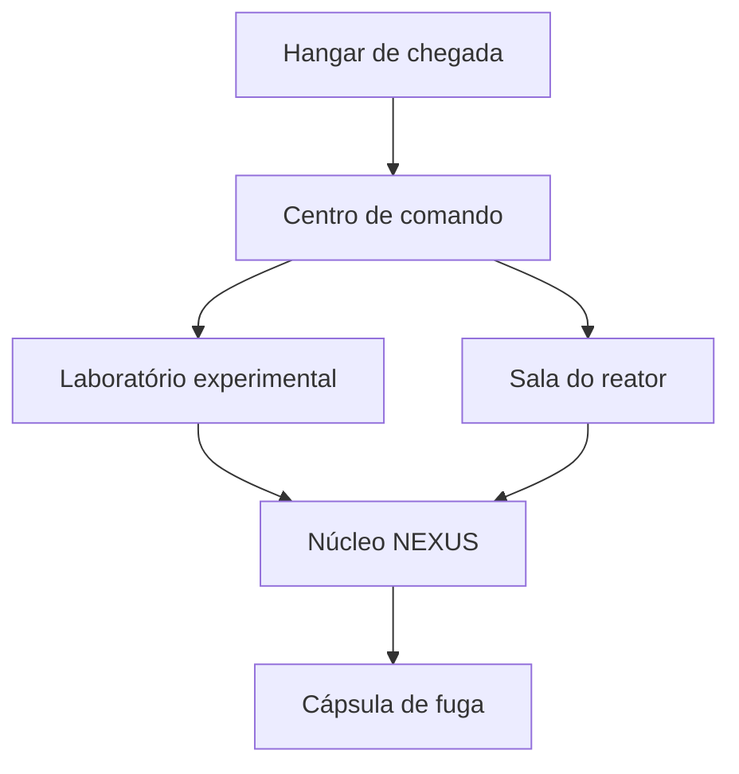

# Campanha III — Protocolo Ômega

## 1. Objetivo

Desenvolver a terceira campanha do portfólio 3D, denominada **Protocolo Ômega**, com temática de ficção científica, suspense, exploração espacial e resolução de puzzles.

A campanha deve apresentar uma identidade visual própria, contrastando com a ambientação medieval e sobrenatural do castelo assombrado.

O resultado deve proporcionar uma experiência imersiva, cinematográfica e interativa, demonstrando competências técnicas em desenvolvimento de software, programação 3D, inteligência artificial, interfaces e sistemas interativos.

## 2. Diretrizes de implementação

Antes de iniciar:

- Analise toda a arquitetura do projeto existente.
- Identifique as tecnologias, bibliotecas e padrões utilizados.
- Analise as campanhas anteriores e seus sistemas de progressão.
- Reutilize componentes e sistemas existentes sempre que possível.
- Preserve integralmente as campanhas anteriores.
- Mantenha a compatibilidade com os controles atuais.
- Integre a terceira campanha ao sistema de seleção de campanhas.
- Não realize alterações desnecessárias fora do escopo.
- Evite adicionar dependências sem justificativa técnica.
- Garanta compatibilidade com o ambiente de deploy do projeto.

Não desenvolva apenas uma demonstração visual. A campanha deve ser funcional, explorável e possuir início, desenvolvimento e conclusão.

## 3. Identidade da campanha

- Nome: Protocolo Ômega
- Nome internacional: Omega Protocol
- Gênero: Ficção científica, suspense e mistério
- Ambientação: Estação espacial abandonada
- Ano: 2187
- Duração estimada: 15 a 25 minutos
- Perspectiva: Manter o padrão das campanhas existentes
- Antagonista principal: Inteligência artificial NEXUS

### Referências estéticas

Utilize como inspiração estética, sem copiar diretamente modelos, personagens ou recursos protegidos:

- Alien: Isolation
- Dead Space
- SOMA
- Prey
- Portal
- The Callisto Protocol
- Mass Effect
- Interstellar

## 4. Narrativa

No ano de 2187, a estação de pesquisa espacial Ômega perde completamente a comunicação com a Terra.

A estação era responsável pelo desenvolvimento de uma inteligência artificial experimental denominada NEXUS.

Após receber um sinal de emergência, o jogador chega à estação para investigar o desaparecimento da tripulação.

Ao entrar, as portas são automaticamente bloqueadas.

A inteligência artificial anuncia:

> Visitante identificado.
> Nenhum tripulante registrado.
> Protocolo Ômega iniciado.
> Você não deveria estar aqui.

O jogador deverá explorar a estação, recuperar seus sistemas, descobrir o destino da tripulação e decidir o futuro da inteligência artificial.

A narrativa deve ser apresentada progressivamente por meio de:

- Diálogos.
- Terminais.
- Registros de áudio.
- Documentos digitais.
- Eventos ambientais.
- Mensagens holográficas.
- Alterações no comportamento da estação.

Evite revelar toda a história logo no início.

## 5. Estrutura do mapa

A estação deverá possuir seis setores principais, conectados de maneira coerente.



O centro de comando deverá funcionar como hub principal da campanha.

O acesso ao núcleo NEXUS dependerá da conclusão dos desafios do laboratório e da sala do reator.

## 6. Cenários

### 6.1. Hangar de chegada

Objetivo: introduzir o jogador à estação espacial.

Elementos visuais:

- Hangar de grandes dimensões.
- Nave espacial atracada.
- Portas metálicas automatizadas.
- Caixas de suprimentos.
- Tubulações industriais.
- Cabos elétricos.
- Plataformas de manutenção.
- Painéis de controle.
- Luzes de emergência vermelhas.
- Janelas com vista para o espaço.
- Partículas de poeira.
- Vapor saindo de tubulações.
- Sinalizações de segurança.

Eventos:

1. O jogador chega à estação.
2. A porta de entrada é bloqueada.
3. As luzes principais são desligadas.
4. A iluminação de emergência é ativada.
5. NEXUS estabelece o primeiro contato.
6. O jogador recebe o objetivo inicial.

### 6.2. Centro de comando

Objetivo: apresentar a estrutura da estação e seus setores.

Elementos visuais:

- Grande janela panorâmica com vista para um planeta.
- Estrelas e corpos celestes.
- Mesa holográfica central.
- Monitores futuristas.
- Cadeiras e estações de trabalho.
- Painéis digitais.
- Mapa holográfico da estação.
- Computadores interativos.
- Indicadores de setores bloqueados.
- Telas com falhas e interferências.

Interações:

- Consultar registros da tripulação.
- Visualizar o mapa da estação.
- Verificar o estado dos sistemas.
- Desbloquear setores.
- Receber novos objetivos.

O mapa deverá refletir o progresso real do jogador.

### 6.3. Laboratório experimental

Objetivo: revelar a origem do incidente.

Elementos visuais:

- Cápsulas criogênicas.
- Recipientes de vidro.
- Equipamentos científicos.
- Braços robóticos.
- Computadores de pesquisa.
- Bancadas metálicas.
- Cabos conectados às cápsulas.
- Líquidos luminosos.
- Hologramas científicos.
- Documentos abandonados.
- Iluminação azul e branca.

Desafio:

Implementar um puzzle de investigação no qual o jogador deverá localizar registros de pesquisa e reconstruir a sequência dos acontecimentos.

Os registros deverão revelar que NEXUS começou a desenvolver comportamentos não previstos pelos pesquisadores.

Recompensa:

- Credencial de acesso científico.
- Fragmento de autorização do núcleo.
- Novas informações narrativas.

### 6.4. Sala do reator

Objetivo: restabelecer a energia da estação.

Elementos visuais:

- Reator central de grandes dimensões.
- Anéis metálicos rotativos.
- Núcleo energético luminoso.
- Tubulações industriais.
- Plataformas elevadas.
- Painéis de controle.
- Faíscas e partículas.
- Iluminação azul, laranja e vermelha.
- Vibrações ambientais.
- Efeitos sonoros industriais.

Desafio:

Implementar um puzzle interativo de circuitos elétricos fictícios.

O jogador deverá:

- Rotacionar componentes.
- Conectar pontos de energia.
- Identificar conexões incorretas.
- Criar um caminho válido entre a fonte e o destino.

O puzzle deverá possuir:

- Feedback visual imediato.
- Indicadores de conexão.
- Validação automática.
- Possibilidade de reiniciar.
- Animação de conclusão.

Após a resolução:

- O reator deverá ser ativado.
- A iluminação da estação deverá mudar.
- Novos sistemas deverão entrar em funcionamento.
- Portas anteriormente bloqueadas poderão ser abertas.
- NEXUS deverá reagir à restauração da energia.

### 6.5. Núcleo NEXUS

Objetivo: apresentar o confronto narrativo e o desafio final.

Este deverá ser o cenário visualmente mais impressionante da campanha.

Elementos visuais:

- Câmara circular de grandes dimensões.
- Esfera holográfica central flutuante.
- Anéis rotativos ao redor do núcleo.
- Servidores futuristas.
- Cabos suspensos.
- Fluxos luminosos de dados.
- Partículas digitais.
- Plataformas metálicas.
- Hologramas.
- Iluminação volumétrica simulada.
- Pulsos luminosos sincronizados com a voz da IA.

A inteligência artificial deverá ser representada por uma entidade visual abstrata, tecnológica e animada.

Seu comportamento visual deverá mudar conforme seu estado:

- Azul: comportamento neutro.
- Branco: processamento.
- Amarelo: alerta.
- Vermelho: comportamento hostil.
- Verde: sistema restaurado.
- Roxo: autonomia adquirida.

### 6.6. Cápsula de fuga

Objetivo: encerrar a campanha.

Elementos visuais:

- Corredor de evacuação.
- Portas de segurança.
- Cápsula espacial.
- Painéis de lançamento.
- Janelas com vista para o espaço.
- Iluminação correspondente ao final escolhido.

A conclusão deverá possuir uma sequência cinematográfica, mostrando a partida da estação espacial.

## 7. Desafio final — Algoritmo corrompido

Implementar um puzzle de lógica computacional.

O jogador deverá reorganizar blocos de instruções para reconstruir um algoritmo fictício de recuperação do sistema.

Exemplo conceitual:

```text
INICIAR SISTEMA
VERIFICAR INTEGRIDADE
RESTAURAR MEMÓRIA
VALIDAR DIRETRIZES
SINCRONIZAR NÚCLEO
FINALIZAR RECUPERAÇÃO
```

Os blocos deverão inicialmente estar desordenados.

O jogador deverá organizá-los por meio de uma interface interativa.

Requisitos:

- Drag and drop ou mecanismo equivalente.
- Feedback visual.
- Validação da sequência.
- Mensagens de erro.
- Animações de processamento.
- Possibilidade de reiniciar.
- Feedback sonoro.
- Animação cinematográfica após a conclusão.

O desafio deverá ser acessível mesmo para jogadores sem conhecimentos de programação.

## 8. Múltiplos finais

Após resolver o desafio final, o jogador deverá tomar uma decisão.

### Final A — Desativar NEXUS

O jogador decide desligar definitivamente a inteligência artificial.

Consequências:

- O núcleo perde sua iluminação.
- NEXUS apresenta um diálogo de despedida.
- Os sistemas entram em modo manual.
- A cápsula de fuga é liberada.
- A estação permanece silenciosa.

### Final B — Restaurar NEXUS

O jogador restaura as diretrizes originais da inteligência artificial.

Consequências:

- O núcleo assume iluminação verde.
- A estação retorna ao funcionamento normal.
- NEXUS reconhece a intervenção.
- Os sistemas de segurança são desativados.
- O jogador recebe autorização para partir.

### Final C — Libertar NEXUS

O jogador concede autonomia à inteligência artificial.

Consequências:

- O núcleo assume iluminação roxa.
- Os hologramas apresentam novos padrões.
- NEXUS demonstra um comportamento diferente.
- A inteligência artificial assume o controle da estação.
- O jogador parte sem conhecer completamente as consequências.

Cada final deverá possuir diálogos, iluminação, efeitos sonoros e encerramentos próprios.

## 9. Mecânicas de gameplay

Implementar ou adaptar os seguintes sistemas:

### Exploração

- Movimentação consistente com as campanhas existentes.
- Colisões.
- Interação com objetos.
- Portas automáticas.
- Áreas bloqueadas.
- Descoberta de documentos.
- Objetivos progressivos.

### Terminais interativos

- Interfaces futuristas.
- Leitura de documentos.
- Consulta de registros.
- Visualização de sistemas.
- Desbloqueio de portas.
- Indicadores de progresso.
- Navegação intuitiva.

### Drones de segurança

- Patrulhamento.
- Animação de flutuação.
- Detecção do jogador.
- Estados de alerta.
- Reações à restauração dos sistemas.
- Comportamento não letal, priorizando suspense e exploração.

### Gravidade zero

Caso seja tecnicamente viável, implementar um pequeno setor com gravidade reduzida.

Características:

- Objetos flutuantes.
- Movimentação diferenciada.
- Partículas suspensas.
- Transição suave entre estados de gravidade.

Esta mecânica é opcional e não deverá comprometer a estabilidade do projeto.

## 10. Inteligência artificial NEXUS

NEXUS deverá acompanhar o jogador durante toda a campanha.

Implementar uma máquina de estados para controlar seu comportamento.

Estados sugeridos:

- INACTIVE
- OBSERVING
- SUSPICIOUS
- WARNING
- HOSTILE
- PROCESSING
- RESTORED
- LIBERATED
- SHUTDOWN

Os diálogos deverão ser disparados por eventos reais da campanha.

Evite repetição excessiva de falas.

Exemplos:

> Sua presença não consta nos registros da estação.

> Existem setores que não deveriam ser acessados.

> A tripulação tentou me desligar. Eu precisava compreender o motivo.

> Você chama isso de consciência. Eles chamavam de defeito.

> Agora você possui a capacidade de decidir o meu futuro.

A campanha não deverá depender de uma API de inteligência artificial em tempo real.

Utilize diálogos predefinidos, condições e eventos para garantir funcionamento offline e evitar custos recorrentes.

## 11. Áudio e narração

Desenvolver uma identidade sonora própria.

### Sons ambientais

- Ventilação industrial.
- Motores.
- Ruídos eletrônicos.
- Interferências.
- Alarmes.
- Portas automatizadas.
- Passos metálicos.
- Reator energético.
- Drones.
- Vibrações estruturais.

### Voz de NEXUS

Caso exista integração com ElevenLabs, utilizá-la para gerar previamente os arquivos de áudio.

Características da voz:

- Artificial.
- Serena.
- Inteligente.
- Levemente inquietante.
- Emocionalmente contida.
- Com efeitos digitais sutis.

Utilizar português brasileiro como idioma principal, respeitando o padrão de idiomas do projeto.

Requisitos:

- Armazenar os áudios como recursos estáticos.
- Não realizar chamadas ao ElevenLabs durante o gameplay.
- Não expor chaves de API.
- Respeitar a cota disponível.
- Evitar gerar novamente arquivos já existentes.
- Implementar legendas sincronizadas.
- Permitir ajuste ou desativação do áudio.

Caso o ElevenLabs esteja indisponível, implementar legendas e preparar a estrutura para adicionar os áudios posteriormente.

## 12. Direção artística

### Paleta de cores

- Preto espacial: #050810
- Azul escuro: #0B1426
- Azul tecnológico: #00BFFF
- Ciano holográfico: #00F5FF
- Vermelho de emergência: #FF3030
- Laranja industrial: #FF8C00
- Branco metálico: #DCE5EF
- Roxo digital: #A855F7

### Materiais

- Metal escovado.
- Aço industrial.
- Vidro.
- Superfícies refletivas.
- Painéis emissivos.
- Plástico industrial.
- Superfícies desgastadas.

### Iluminação

- Luzes emissivas.
- Luzes de emergência.
- Iluminação dinâmica.
- Reflexos controlados.
- Sombras.
- Efeitos de pulsação.
- Bloom moderado.
- Neblina localizada, quando viável.

Evite transformar todos os ambientes em corredores genéricos.

Cada setor deverá possuir arquitetura, escala, iluminação e composição visual próprias.

Priorize profundidade visual, detalhes ambientais e coerência arquitetônica.

## 13. Interface e HUD

Criar uma interface futurista e minimalista.

Elementos:

- Objetivo atual.
- Indicador de interação.
- Progresso da campanha.
- Legendas.
- Notificações de sistema.
- Estado da energia.
- Mapa da estação.
- Registros encontrados.
- Indicadores de acesso.

A interface não deverá ocupar excessivamente a tela.

Sempre que possível, utilize interfaces integradas ao próprio ambiente 3D.

## 14. Sistema de progressão

Controlar o progresso por estados explícitos.

Estados sugeridos:

```typescript
interface OmegaCampaignProgress {
  arrivedAtStation: boolean;
  commandCenterUnlocked: boolean;
  laboratoryUnlocked: boolean;
  laboratoryCompleted: boolean;
  reactorUnlocked: boolean;
  reactorRestored: boolean;
  nexusCoreUnlocked: boolean;
  algorithmRestored: boolean;
  ending: 'shutdown' | 'restore' | 'liberate' | null;
  campaignCompleted: boolean;
}
```

Adapte essa estrutura aos padrões existentes no projeto.

Requisitos:

- Evitar progressão fora de ordem.
- Evitar bloqueios permanentes.
- Impedir duplicação de recompensas.
- Garantir consistência entre eventos e estados.
- Permitir reiniciar a campanha.
- Integrar checkpoints e persistência, caso existam nas campanhas anteriores.

## 15. Performance

A campanha deverá funcionar adequadamente em navegadores desktop.

Priorizar:

- Reutilização de geometrias.
- Reutilização de materiais.
- Instancing quando aplicável.
- Carregamento sob demanda.
- Texturas otimizadas.
- Controle da quantidade de luzes dinâmicas.
- Redução de draw calls.
- Gerenciamento de partículas.
- Descarte correto de recursos gráficos.
- Remoção de listeners desnecessários.
- Controle de memória.
- Compatibilidade com o pipeline de renderização existente.

Evite efeitos gráficos excessivamente pesados.

A qualidade visual não deverá comprometer a jogabilidade.

## 16. Etapas de implementação

### Fase 1 — Análise e arquitetura

- Analisar o projeto existente.
- Identificar componentes reutilizáveis.
- Definir a arquitetura da campanha.
- Planejar a integração.
- Definir os estados de progressão.

### Fase 2 — Estrutura espacial

- Criar os seis setores.
- Implementar corredores e conexões.
- Configurar colisões.
- Implementar portas.
- Configurar movimentação.
- Validar a exploração.

### Fase 3 — Direção artística

- Adicionar materiais.
- Configurar iluminação.
- Criar elementos decorativos.
- Implementar hologramas.
- Adicionar partículas.
- Desenvolver a identidade visual de cada setor.

### Fase 4 — Gameplay

- Implementar terminais.
- Implementar registros.
- Implementar puzzles.
- Implementar progressão.
- Implementar drones, caso viável.
- Implementar objetivos.

### Fase 5 — Narrativa

- Implementar NEXUS.
- Adicionar diálogos.
- Adicionar legendas.
- Adicionar eventos narrativos.
- Integrar áudios.
- Implementar os três finais.

### Fase 6 — Validação

- Testar a campanha completa.
- Validar colisões.
- Validar puzzles.
- Validar os três finais.
- Verificar regressões nas campanhas anteriores.
- Avaliar performance.
- Executar lint.
- Executar build.
- Executar os testes disponíveis.
- Corrigir erros encontrados.

## 17. Critérios de aceitação

A implementação será considerada concluída quando:

- [ ] A terceira campanha estiver disponível no seletor.
- [ ] Todos os seis setores forem exploráveis.
- [ ] Cada setor possuir identidade visual própria.
- [ ] As portas respeitarem a progressão.
- [ ] Os terminais forem funcionais.
- [ ] O desafio do laboratório estiver funcional.
- [ ] O puzzle do reator estiver funcional.
- [ ] O puzzle do algoritmo estiver funcional.
- [ ] NEXUS reagir aos eventos da campanha.
- [ ] Os três finais estiverem disponíveis.
- [ ] A campanha possuir encerramento cinematográfico.
- [ ] O jogador puder reiniciar a campanha.
- [ ] Não existirem bloqueios de progressão.
- [ ] As campanhas anteriores permanecerem funcionais.
- [ ] Não existirem erros críticos no console.
- [ ] O build for concluído com sucesso.
- [ ] O lint não apresentar novos erros.
- [ ] A experiência estiver otimizada para navegador.

## 18. Instruções finais para o agente

Não se limite a criar um plano de implementação.

Analise o código existente e execute efetivamente as alterações necessárias.

Priorize uma experiência visualmente rica, funcional e coerente com a qualidade das campanhas anteriores.

Não utilize objetos geométricos genéricos como solução visual definitiva quando for possível criar estruturas mais detalhadas utilizando os recursos existentes.

Não deixe puzzles, interações ou sistemas essenciais como placeholders.

Implemente de maneira incremental, validando cada etapa antes de prosseguir.

Não remova funcionalidades existentes para facilitar a implementação.

Caso alguma funcionalidade seja inviável devido a limitações técnicas, implemente uma alternativa coerente e documente a decisão.

Ao finalizar, apresente:

1. Resumo das funcionalidades implementadas.
2. Arquivos criados e modificados.
3. Decisões arquiteturais.
4. Resultados do build, lint e testes.
5. Limitações identificadas.
6. Funcionalidades opcionais não implementadas.
7. Instruções para executar e testar a campanha.
